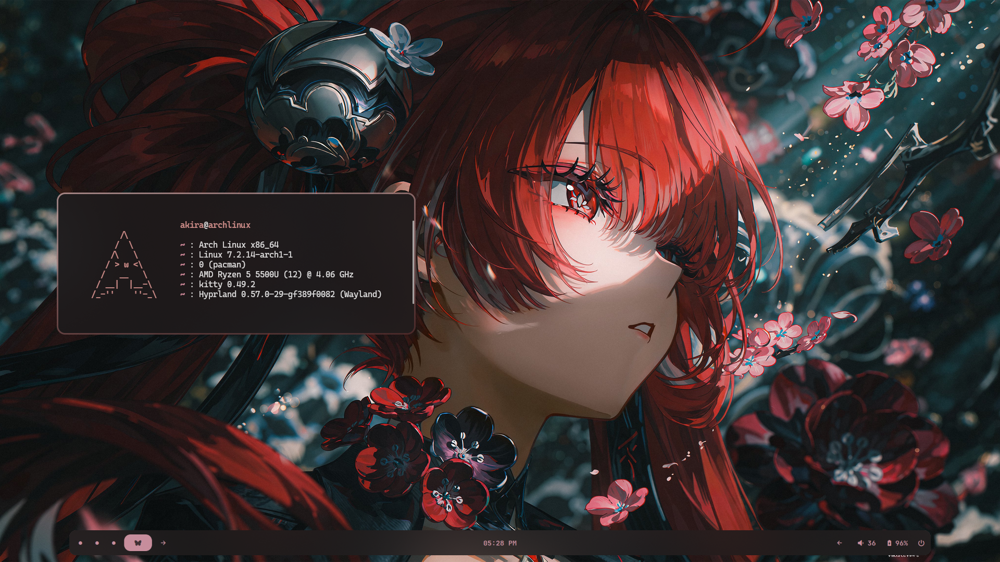

# dotfiles-H

My personal dotfiles, managed with [yadm](https://yadm.io/) and built on top of [HyDE](https://github.com/HyDE-Project/HyDE) (HyDE Project, for Arch Linux / Hyprland).

## Preview



---

## Requirements

- Arch Linux (or an Arch-based distro)
- A working internet connection
- `git` and `sudo` access
- A **fresh** install is recommended. Back up anything you care about first (see [Backup](#backup)).

---

## Installation

### 1. Install HyDE

```bash
sudo pacman -S --needed git base-devel
git clone --depth 1 https://github.com/HyDE-Project/HyDE ~/HyDE
cd ~/HyDE/Scripts
./install.sh
```

When the installer asks for your choices, pick these options in order:

| # | Option          |
|---|-----------------|
| 1 | `pochita (otn)` |
| 2 | `yay`           |
| 3 | `zsh`           |
| 4 | `ffmpeg`        |
| 5 | `all`           |

Let the installer finish, then **reboot**.

### 2. Install yadm

```bash
sudo pacman -S yadm
```

(or `yay -S yadm`)

### 3. Clone this repo

```bash
yadm clone https://github.com/RyuuseiAkira/dotfiles-H.git
```

yadm clones the repo as a *bare* repository and tries to check files out into `$HOME`.

### 4. Resolve conflicts (if any)

If yadm warns that some files already exist (HyDE creates a lot of them), your versions from this repo need to overwrite them. Run:

```bash
yadm checkout "$HOME"
```

If that still complains, force it. **This overwrites existing files in `$HOME` that are tracked by this repo**, so make sure you have a backup:

```bash
yadm fetch origin
yadm reset --hard origin/main
```

> Replace `main` with the repo's default branch name if it's different.

### 5. Reload

Log out and back in (or reboot) so Hyprland, Waybar, your shell and theme pick up the new configs.

### 6. Set the theme and wallpaper

Switch to the **akira** theme using the HyDE theme selector, or from the terminal:

```bash
hydectl theme set "akira"
```

Then pick a wallpaper you like using the HyDE wallpaper selector.

### 7. Change the Waybar style

Choose a Waybar layout:

```bash
~/.local/lib/hyde/waybar.py --select-layout
```

This opens a GUI. Select **`akira_f`**.

Then choose a Waybar style:

```bash
~/.local/lib/hyde/waybar.py --select-style
```

This also opens a GUI. Select **`akira_f`** here too.

> ⚠️ **Note:** Some of the Waybar scripts in this setup are tied to my machine and **will not work on another machine** out of the box. If a module stays empty, remove it in `$HOME/.local/share/waybar/layouts/akira_F.jsonc`.

---

## Backup

Before applying, back up your current config:

```bash
cp -r ~/.config ~/.config.bak
cp ~/.zshrc ~/.zshrc.bak 2>/dev/null
```

---

## Updating

To get the latest version of these dotfiles later:

```bash
yadm pull
```

If you edited tracked files locally and `pull` complains, stash first:

```bash
yadm stash
yadm pull
yadm stash pop
```

---

## Credits

- [HyDE Project](https://github.com/HyDE-Project/HyDE), the base setup this is built on
- [yadm](https://yadm.io/), dotfiles manager

---

## Disclaimer

These are my personal configs and are provided as-is. They may overwrite your existing settings, so back up first and use at your own risk.
